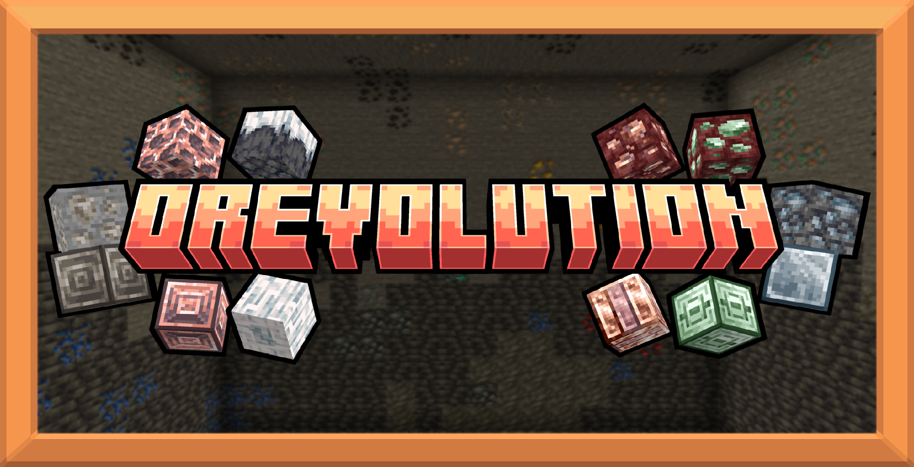

 

This mod expands Minecraft's main progression with six new ores, two (optional) new alloys, and unique abilities for both new and vanilla materials.

### If you were looking for...
- #### Where to download this mod, you can do it through the official pages:
  - Modrinth: https://modrinth.com/mod/orevolution/versions
  - Curseforge: https://www.curseforge.com/minecraft/mc-mods/orevolution
- #### Ways to integrate your mod with Orevolution (Compatibility):
  - You can look at [RegOther.java](https://github.com/Bexlax/Orevolution-neoforge/blob/master/src/main/java/net/bexla/orevolution/init/RegOthers.java) to understand how Powers, Custom Durability and configurable tool tiers can be registered
    - To modify the required progression of the game, you must use Tags. Search for "NEEDS_STONE_TOOL" and "INCORRECT_FOR_STONE_TOOL" in [GENBlockTags.java](https://github.com/Bexlax/Orevolution-neoforge/blob/master/src/main/java/net/bexla/orevolution/datagen/GENBlockTags.java) to understand how it was done here.
- #### The 1.20.1 Repository is:
  - Due to i don't know what phenomenon, i was unable to commit any changes so i had to make another repository. you can still visit it at https://github.com/Bexlax/Orevolution
---

---

---
_This prison… To hold... **ME**?_

A visitor? Hmm… Indeed, I have slept long enough. The kingdom of Heaven has long since forgotten my name, and I am _EAGER_ to make them remember. However, the blood of Minos stains your hands, and I must admit… I'm curious about your skills, weapon. And so, before I tear down the cities and CRUSH the armies of Heaven… You shall do as an appetizer. Come forth, Child of Man… And _DIE_.